[](https://crates.io/crates/turbofox)
[](https://docs.rs/turbofox)
[](https://github.com/pid7-org/turbofox/actions/workflows/tests.yaml)
[](#usage)
[](LICENSE-MIT)

TurboFox is an embedded, memory-mapped key-value engine providing lock-free concurrency & explicit
sync barriers

> [!IMPORTANT]
> On-disk storage formats and public interfaces remain subject to breaking changes; persistence
> compatibility across releases is not guaranteed without re-creating the database
>
> Prototyping, benchmarking, and integration testing are all encouraged, while production
> deployments must account for potential format migrations

## Index

- [Usage](#usage)
- [Features](#features)
  - [§1 · Point Mutations: SET & DEL](#1--point-mutations-set--del)
  - [§2 · Zero-Allocation Retrieval: GET & CONTAINS_KEY](#2--zero-allocation-retrieval-get--contains_key)
  - [§3 · Durability Pipeline: TurboTicket & Sync Barriers](#3--durability-pipeline-turboticket--sync-barriers)
  - [§4 · Embedded Sequences: TurboList](#4--embedded-sequences-turbolist)
  - [§5 · Configuration & Lifecycle: TurboCfg](#5--configuration--lifecycle-turbocfg)
  - [§6 · Page Cache Eviction & Telemetry: evict](#6--page-cache-eviction--telemetry-evict)
- [Architecture Guarantees](#architecture-guarantees)
  - [§1 · Zero Global Rehash & 15-Way Prefix Folding](#1--zero-global-rehash--15-way-prefix-folding)
  - [§2 · Torn-Write Immunity & Checksum Verification](#2--torn-write-immunity--checksum-verification)
  - [§3 · Optimistic Concurrency Control & Deadlock Freedom](#3--optimistic-concurrency-control--deadlock-freedom)
  - [§4 · Storage Topography & Demand-Paged Footprint](#4--storage-topography--demand-paged-footprint)
  - [§5 · RAII Safety & Graceful Shutdown Protocol](#5--raii-safety--graceful-shutdown-protocol)
- [Supported Platforms](#supported-platforms)
- [Benchmarks](#benchmarks)
  - [§1 · Concurrency Dynamics & Throughput Scaling](#1--concurrency-dynamics--throughput-scaling)
  - [§2 · Tail Latency Spectrum & Percentile CDF](#2--tail-latency-spectrum--percentile-cdf)
  - [§3 · Memory Residency & Resident Set Size (RSS)](#3--memory-residency--resident-set-size-rss)
  - [§4 · Cold-Open Latency & Index Memory Density](#4--cold-open-latency--index-memory-density)

## Usage

Add `turbofox` to your `Cargo.toml`,

```toml
[dependencies]
turbofox = "0.0.300"
```

> [!NOTE]
> Minimum Supported Rust Version (MSRV) is `1.89.0`

## Features

### §1 · Point Mutations: SET & DEL

Mutations execute via optimistic concurrency control (OCC) directly against memory-mapped pages,

* Inserts assign slots dynamically; in-place overwrites execute without reallocation when updated
  payloads fit existing slot capacity
* Monotonic expansion bounds heap fragmentation; slots expand dynamically when updated values
  exceed prior allocations
* In-place slot reclamation via `del` marks tombstones directly without global table redistribution
  or stop-the-world compaction cycles
* Operational bounds: key length $\in [0x01, 0xFF]$ bytes (255 B); value length $\le 0xFFFF$
  bytes (65,535 B)
* OCC conflict retry loop resolves concurrent multi-threaded writes automatically (retrying up to
  0x20 times under contention)

```rust
use turbofox::{TurboCfg, TurboFox};

let dir = tempfile::tempdir().unwrap();
let db = TurboFox::create(TurboCfg::manual(dir.path())).unwrap();

// Initial write: commits slot in memory and returns commit epoch ticket
let ticket = db.set(b"session:0x42", b"user_active").unwrap();
assert!(ticket.epoch() > 0x00);

// In-place overwrite: updates in place without allocating new storage slots
db.set(b"session:0x42", b"user_idle").unwrap();
assert_eq!(db.get(b"session:0x42").unwrap(), Some(b"user_idle".to_vec()));

// In-place slot reclamation: frees key-value slot without table redistribution
assert!(db.del(b"session:0x42").unwrap());
assert!(!db.del(b"session:0x42").unwrap());

db.delete().unwrap();
```

> [!NOTE]
> In-place overwrites incur zero storage expansion overhead when new payload length remains within
> previously allocated slot capacity

### §2 · Zero-Allocation Retrieval: GET & CONTAINS_KEY

Point reads execute lock-free directly against memory-mapped pages without shared mutex acquisition,

* Lock-free point lookups route through 32-bit XxHash32 bucket chains
* Checksum integrity verification: every payload read validates CRC32 integrity alongside
  byte-level key equality; torn reads from concurrent writes fail safely via
  `TurboError::CorruptedPayload`
* Zero-allocation key presence probe: `contains_key` probes bucket presence without copying or
  allocating value payload buffers on the heap
* Lookup misses short-circuit at bucket index level without touching data payload pages; zero
  heap allocations occur on non-existent keys

```rust
use turbofox::{TurboCfg, TurboFox};

let dir = tempfile::tempdir().unwrap();
let db = TurboFox::create(TurboCfg::manual(dir.path())).unwrap();

db.set(b"device:sensor_01", b"temp=21.4C;humidity=45%").unwrap();

// Zero-allocation existence probe: resolves without heap Vec allocations
assert!(db.contains_key(b"device:sensor_01").unwrap());
assert!(!db.contains_key(b"device:sensor_99").unwrap());

// Value retrieval: verifies CRC32 checksum before copying payload bytes
let payload = db.get(b"device:sensor_01").unwrap();
assert_eq!(payload, Some(b"temp=21.4C;humidity=45%".to_vec()));

db.delete().unwrap();
```

> [!TIP]
> Prefer `contains_key` over `get` whenever existence verification does not consume payload bytes;
> probing inspects index headers directly, avoiding heap allocations entirely

### §3 · Durability Pipeline: TurboTicket & Sync Barriers

Decouples high-frequency in-memory mutation throughput from physical NVMe writeback latency,

* Monotonic epoch tracking: mutations (`set`, `del`, `append`, `pop`) return a lightweight
  `TurboTicket` bound to a strictly increasing commit epoch
* Non-blocking verification: `ticket.is_durable()` checks hardware writeback status atomically
  without parking the calling thread
* Cumulative barrier invariant: physical flushes advance the durable epoch monotonically;
  establishing a barrier for epoch $E$ guarantees all mutations with epochs $\le E$ are persisted
  to disk
* Flexible durability policies,
  * *Per-Write Sync*: call `ticket.force()` immediately for strict hardware durability at each write
  * *Batched Epoch Sync*: execute multi-mutation batches in memory at multi-million ops/sec, then
    issue a single barrier on the final ticket to persist the entire batch simultaneously

```rust
use turbofox::{TurboCfg, TurboFox};

let dir = tempfile::tempdir().unwrap();
let db = TurboFox::create(TurboCfg::manual(dir.path())).unwrap();

// Pattern A · Strict Per-Write Sync (~26 kops/s on NVMe)
// Forces physical msync on every mutation; throughput bounded by SSD writeback latency
for i in 0..0x0A {
    let key = format!("strict:0x{:x}", i);
    let ticket = db.set(key.as_bytes(), b"state").unwrap();
    ticket.force().unwrap(); // Blocks calling thread until persisted on NVMe
}

// Pattern B · Batched Epoch Sync (~1+ Mops/s throughput)
// Mutations commit to memory pages at memory bus speeds;
// Calling force() on the final ticket commits all preceding mutations in a single hardware barrier
let mut last_ticket = None;
for i in 0..0x03E8 {
    let key = format!("batch:0x{:x}", i);
    last_ticket = Some(db.set(key.as_bytes(), b"metric").unwrap());
}

if let Some(ticket) = last_ticket {
    ticket.force().unwrap(); // Single sync barrier persists all 0x03E8 mutations
    assert!(ticket.is_durable());
}

db.delete().unwrap();
```

> [!IMPORTANT]
> Durability barriers are epoch-cumulative; calling `ticket.force()`, `ticket.wait()`, or
> `db.sync()` on ticket $N$ atomically persists all pending mutations $0..N$ in one physical flush

### §4 · Embedded Sequences: TurboList

Ordered 1-to-N sequences co-located inside the primary container file without auxiliary tables or
relational join overhead,

* Sequential appends and pops execute with amortized O(1) complexity
* Boundary inspection via `first` and `last` inspects queue extremes without traversing elements
* Zero-based random access via `get_at` fetches items by ordinal position
* Demand-paged forward iteration via `iter` streams active items with O(1) payload footprint
* Pre-read slot validation terminates iteration cleanly if trailing items are popped
* Per-item CRC32 checksums validate payload integrity on every retrieval

```rust
use turbofox::{TurboCfg, TurboFox};

let dir = tempfile::tempdir().unwrap();
let db = TurboFox::create(TurboCfg::manual(dir.path())).unwrap();

let list = db.list(b"jobs:stream");

// Amortized O(1) sequential appends into memory-mapped contiguous arrays
list.append(b"job_1").unwrap();
list.append(b"job_2").unwrap();
list.append(b"job_3").unwrap();
assert_eq!(list.len().unwrap(), 0x03);

// Boundary probes without traversing the underlying array
assert_eq!(list.first().unwrap(), Some(b"job_1".to_vec()));
assert_eq!(list.last().unwrap(), Some(b"job_3".to_vec()));

// O(1) indexed random access by 0-based position
assert_eq!(list.get_at(0x01).unwrap(), Some(b"job_2".to_vec()));

// Demand-paged forward iterator verifying per-item CRC32 integrity
let items: Vec<_> = list.iter().unwrap().collect();
assert_eq!(items.len(), 0x03);

// Stack/queue pop and slot reclamation
assert_eq!(list.pop().unwrap(), Some(b"job_3".to_vec()));
assert!(list.clear().unwrap());
assert!(list.is_empty().unwrap());

drop(list);
db.delete().unwrap();
```

> [!NOTE]
> `TurboList` operations share memory-mapped adjacent array descriptor blocks; calling `clear()`
> reclaims descriptor slots in place without file truncation or storage reorganization;
> `iter()` snapshots compact 12 B index descriptors upfront and validates slot occupancy before
> reading payloads, halting cleanly without reading recycled memory if concurrent pops occur

### §5 · Configuration & Lifecycle: TurboCfg

Engine initialization, sync policies, and storage pre-allocation parameters,

* Durability policies,
  * `SyncMode::Manual`: caller retains explicit control over flush timing and background threads
  * `SyncMode::Periodic(Duration)`: spawns a background thread coalescing dirty pages at interval
* Upfront storage sizing via `CapacityHint`: pre-allocates backing database files to avoid
  runtime `mmap` expansion latency spikes during high-throughput ingestion
* Lookup cache mode: trade-off between instant cold startup (4 KiB RSS) and pre-indexed memory
  lookups for read-intensive workloads

```rust
use std::time::Duration;
use turbofox::{CapacityHint, SyncMode, TurboCfg, TurboFox};

let dir = tempfile::tempdir().unwrap();
let path = dir.path();

// Pre-size container upfront to eliminate runtime mmap expansion pauses
let hint = CapacityHint::new()
    .with_kv(0x0001_86A0, 0x10, 0x20)
    .with_list(0x0400, 0x08, 0x40);

// Manual sync mode: caller retains total control over flush timing and threads
let manual_cfg = TurboCfg::manual(path).with_capacity_hint(hint);
let db = TurboFox::open_or_create(manual_cfg).unwrap();

// Periodic sync mode: dedicated background worker flushes at interval
let periodic_cfg = TurboCfg::periodic(path, Duration::from_millis(0x32));
assert_eq!(periodic_cfg.sync_mode, SyncMode::Periodic(Duration::from_millis(0x32)));

db.delete().unwrap();
```

TurboFox provides three distinct initialization entry points to match operational requirements,

| Method           | Target Exists | Target Missing | Target Corrupt | Recommended Use Case        |
|:-----------------|:--------------|:---------------|:---------------|:----------------------------|
| `open_or_create` | Opens DB      | Formats DB     | Fails (`Err`)  | Application boot sequences  |
| `create`         | Fails (`Err`) | Formats DB     | N/A            | Provisioning & cold setups  |
| `open`           | Opens DB      | Fails (`Err`)  | Fails (`Err`)  | Strict crash restarts       |

> [!TIP]
> Use `CapacityHint` in write-heavy environments to pre-size storage pages upfront, eliminating
> runtime memory-map resizing and bounding tail write latency

### §6 · Page Cache Eviction & Telemetry: evict

Granular control over OS page cache residency and backing storage footprint,

* Advisory cache trimming via `evict`: advises host kernel page tables to release clean file-backed
  pages to relieve physical RAM pressure
* `EvictionMode::PreserveHeaders`: unmaps data pages while retaining index headers hot in RAM
* `EvictionMode::PurgeAll`: unmaps all database pages across virtual address space; subsequent
  reads demand-page faulted blocks back into physical RAM
* Automatic pre-eviction sync: flushes dirty pages before dispatching kernel eviction hints,
  ensuring crash consistency and marking outstanding tickets durable
* Telemetry metrics: inspect active page residency via `resident_bytes_in_memory()` and file
  allocation via `resident_bytes_on_disk()`

```rust
use turbofox::{EvictionMode, TurboCfg, TurboFox};

let dir = tempfile::tempdir().unwrap();
let db = TurboFox::create(TurboCfg::manual(dir.path())).unwrap();

db.set(b"hot_key", b"payload_bytes").unwrap();

// Telemetry: inspect physical memory residency vs disk allocation
assert!(db.resident_bytes_in_memory().unwrap() > 0x00);
assert!(db.resident_bytes_on_disk() >= 0x4000); // 16 KiB initial footprint

// Pre-eviction sync flushes dirty pages automatically;
// Sheds cold data pages from physical RAM while keeping index headers hot
db.evict(EvictionMode::PreserveHeaders).unwrap();

// Subsequent read faults evicted page back into physical memory on demand
assert_eq!(db.get(b"hot_key").unwrap(), Some(b"payload_bytes".to_vec()));

db.delete().unwrap();
```

## Architecture Guarantees

TurboFox provides deterministic guarantees across storage layouts, index routing, concurrent
execution, and physical media writeback

Reference documentation and method signatures are available on [docs.rs](https://docs.rs/turbofox)

### §1 · Zero Global Rehash & 15-Way Prefix Folding

Primary routing is governed by an embedded 15-way radix trie backed by 32-bit `XxHash32`,

* Hash Bit-Slicing & Folding: key hashes decompose into 4-bit slices across eight depth levels
  (`depth % 8`); slice values $S \in [0, 15]$ fold $15 \to 0$ to address 15 child branches
  without integer division
* Leaf Bucket Topography: leaf nodes terminate in 256-byte Buckets (4 slots) holding 32 entry
  hashes and 32 buffer offsets; candidate hashes are scanned in parallel via SIMD vector
  instructions (AVX-512 / AVX2 / SSE2 / NEON)
* Localized Bucket Splitting: when a bucket exceeds 32 entries at `depth < 0x08`, the engine
  allocates 14 new Buckets and 1 routing Node from `free_slot_marker`; entries with
  `child_idx == 0` are compacted in place, while entries $1..14$ route into new child Buckets
* Atomic Pointer Publication: the new Node is published to the parent via an atomic optimistic
  pointer swap, transitioning readers instantly without write-ahead logs or intermediate states
* Bounded Tail Latency: bucket splits are strictly localized to 14 child buckets; global table
  redistributions and stop-the-world compaction cycles do not exist

> [!NOTE]
> Hash collisions at `MAX_TRIE_DEPTH` (0x08) return `TurboError::Storage` rather than entering
> unbounded recursive allocations, preserving predictable memory bounds

### §2 · Torn-Write Immunity & Checksum Verification

Point lookups execute lock-free directly against memory-mapped virtual address space,

* Lock-Free Point Reads: point readers bypass read-write locks, spinlocks, and shared reference
  counters; reads navigate mapped pages without generating CPU cache coherency traffic
* CRC32 Payload Framing: every stored key-value and list item prepends an 8-byte framing descriptor
  containing an endian-independent CRC32 checksum, key length (`klen`), and payload length (`vlen`)
* Fast 2-Buffer Collision Filtering: buffer 0 loads header framing, buffer 1 loads the initial
  8-byte key prefix; if `klen` or key prefix mismatches, hash collisions abort immediately
  without touching payload pages
* Safe Torn-Read Rejection: concurrent writes or partial page writebacks that cause torn reads fail
  safely via `TurboError::CorruptedPayload` rather than surfacing corrupted state
* Zero Heap Allocation on Miss: non-existent keys terminate at the bucket index level; misses return
  `Ok(None)` with zero heap allocations and zero payload page accesses

> [!TIP]
> Lock-free reads and zero-allocation misses ensure read latency percentiles ($p50$ through $p9999$)
> remain flat and unaffected by concurrent write volume

### §3 · Optimistic Concurrency Control & Deadlock Freedom

Mutations execute through atomic multi-slot transactions governed by optimistic concurrency control,

* Slot-Level Granularity: transactions operate on discrete 64-byte `Slot` boundaries;
  writers compute mutations in private memory before staging slot modifications
* Deadlock Prevention Guarantee: target slot indices are sorted in strictly ascending numerical
  order before lock acquisition; ordered acquisition mathematically eliminates circular wait
  conditions, guaranteeing deadlock-free execution
* Atomic Conflict Validation: commits verify that target slots match expected pre-state before
  applying updates; on conflict, locks release immediately, and the writer retries with randomized
  exponential backoff ($50\,\mu\text{s}..10\,\text{ms}, \pm 25\%$ jitter) up to 0x20 cycles
* Non-Blocking Telemetry Counter: active entry count (`total_entries`) is tracked in memory via
  `AtomicU64`, preventing writer cache-line contention on Metadata Slot 0; Slot 0 flushes during
  sync barriers

> [!NOTE]
> Multi-transaction write conflicts resolve through OCC backoff loops; under uncontended workloads,
> write transactions commit in sub-microsecond intervals

### §4 · Storage Topography & Demand-Paged Footprint

Unified single-file container layout mapped across virtual address space,

* Quantized Component Geometry: all internal structures align to 8 bytes and occupy uniform 64-byte
  `Slot` multiples (Metadata = 1 slot, Node = 1 slot, AdjArr = 2 slots, Bucket = 4 slots,
  DBuf = 4 slots)
* Demand-Paged Virtual Mapping: reserves up to `MAX_DB_LEN` (0x40_0000_0000 bytes / 256 GiB)
  upfront in virtual memory; physical disk blocks back pages lazily as data is written
* Monotonic Slot Allocation: internal allocations advance `free_slot_marker` in 256-byte quanta
  (4 slots), avoiding external fragmentation
* Synchronized File Growth: when capacity exhausts, writers coordinate under `growth_mutex` using
  double-checked locking to grow the backing file in OS page increments (16 KiB on 4 KiB/16 KiB
  systems, 64 KiB on 64 KiB systems)
* Initial Storage Footprint: cold database layout occupies exactly 8 KiB (128 slots) across
  16 KiB initial file allocation

> [!NOTE]
> Virtual memory reservation (256 GiB) does not consume physical host RAM; physical residency tracks
> active working set pages demand-faulted by the host kernel

### §5 · RAII Safety & Graceful Shutdown Protocol

Resource management separates host OS cleanup from physical data durability,

* RAII Resource Reclamation: dropping `TurboFox` unmaps virtual address space, releases heap
  allocations, closes backing file handles, and releases advisory file locks without leaks
* Drop Durability Boundary: Rust's `Drop` implementation initiates a best-effort flush, but
  discards errors; physical I/O faults cannot be surfaced during drop
* Explicit Shutdown Barrier: production systems performing graceful shutdown must establish an
  explicit sync barrier (`ticket.wait()`, `ticket.force()`, or `db.sync()`) and verify the returned
  `Result` prior to handle destruction
* Single-Process Exclusivity: enforced at startup via mandatory advisory file locks (`flock` on
  Unix, `LockFileEx` on Windows); opening an active database concurrently returns
  `TurboError::Storage`

> [!WARNING]
> Dropping a database handle without invoking `sync()` or awaiting outstanding tickets risks data
> loss if host system power fails before the OS page cache writes dirty pages to disk

## Supported Platforms

TurboFox supports 64-bit architectures across major operating systems; all target platforms are
validated under automated multi-platform CI pipelines,

| Architecture | OS        | Page Size             | ISA                 |
|:-------------|:----------|:----------------------|:--------------------|
| `x86_64`     | Linux     | 4 KiB                 | AVX-512, AVX2, SSE2 |
| `x86_64`     | macOS     | 4 KiB                 | AVX2, SSE2          |
| `x86_64`     | Windows   | 4 KiB                 | AVX2, SSE2          |
| `aarch64`    | Linux     | 4 KiB, 16 KiB, 64 KiB | NEON                |
| `aarch64`    | macOS     | 16 KiB                | NEON                |
| `aarch64`    | Windows   | 4 KiB                 | NEON                |

* Vector acceleration automatically detects CPU ISA features at runtime to drive SIMD hash scanning
* Host page sizes (4 KiB, 16 KiB, 64 KiB) are detected dynamically to align allocation growth
  quanta
* Process exclusivity is enforced across all platforms via kernel-level mandatory advisory
  file locks

## Benchmarks

Benchmarks execute on dedicated bare-metal cloud instances with direct NVMe block storage,

- Host instance: AWS EC2 `c6id.xlarge` (0x04 vCPUs, 0x02 physical cores,
  Intel Xeon Platinum 8375C CPU @ 2.90GHz, AVX-512 / AVX2 / SHA-NI vector extensions)
- Host memory: 0x08 GiB host DDR4 system RAM (8,153,268,224 bytes); Linux hugepages enabled at
  0x02 MiB (2,097,152 bytes)
- Storage target: Direct local NVMe SSD (`/dev/nvme1n1`, mounted at `/mnt/nvme0n1`), formatted
  under XFS (`rw,noatime,nodiratime,inode64,allocsize=65536k,logbufs=8,logbsize=256k,noquota`)
- Operating system: Linux `7.0.0-1014-aws` (x86_64)
- Operation volume: 0x10_0000 (1,048,576) uniform operations per key-value suite; scaling
  benchmarks sweep from 0x00 to 0x8000 (32,768) keys

### §1 · Concurrency Dynamics & Throughput Scaling

Throughput evaluations measure sustained operations per second comparing single-thread execution
against concurrent worker transactions across 0x10_0000 operations; workloads evaluate mutation
writes (`SET` with 80% new keys and 20% updates), point lookups (`GET` with 60% hits and 40%
misses), and key deletions (`DEL` with 60% present keys and 40% missing)

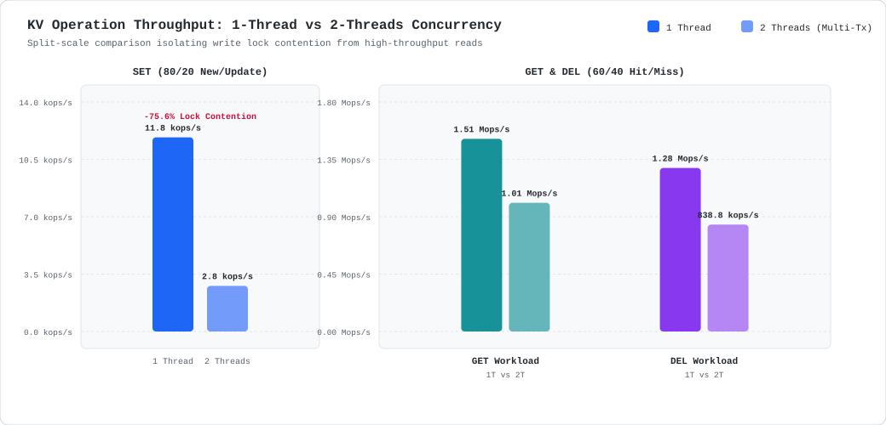

Point reads and deletions execute with sub-microsecond internal dispatch; because point reads are
lock-free and execute directly against memory-mapped pages without shared mutex acquisition,
concurrency overhead on read throughput is dominated by CPU L1/L2 cache coherency traffic and memory
bus contention between physical cores rather than engine-level synchronization barriers

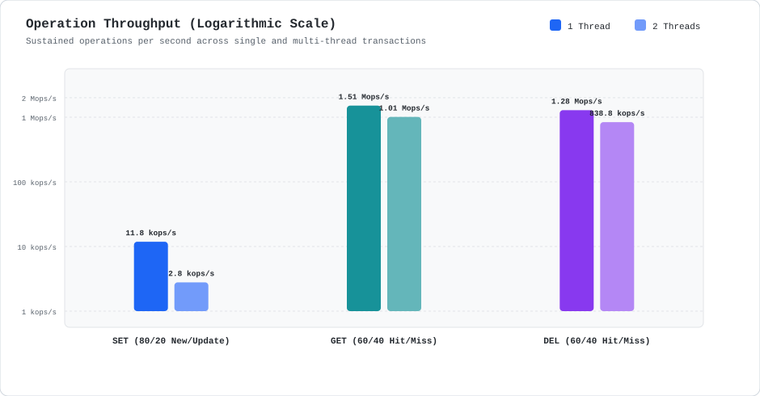

The continuous logarithmic throughput profile illustrates the architectural divide between
in-memory dispatch and persistent storage commits; point reads and deletes operate across the
mega-ops spectrum while writes track the persistent NVMe barrier regime

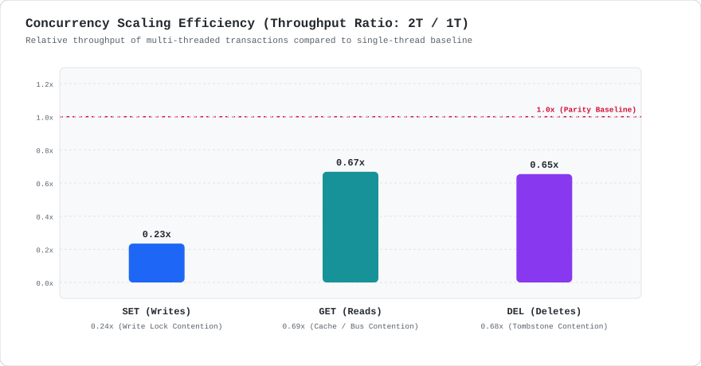

In contrast, mutation writes (`SET`) isolate write lock and transaction commit contention,

* Single-thread writes commit sequentially into memory pages with minimal OCC transaction overhead
* Concurrent multi-transaction writes validate optimistic concurrency control (OCC) epochs,
  serialize atomic commit tickets, and synchronize page-level modifications; competing writers
  incur OCC retry cycles and page writeback delays under concurrent transaction pressure

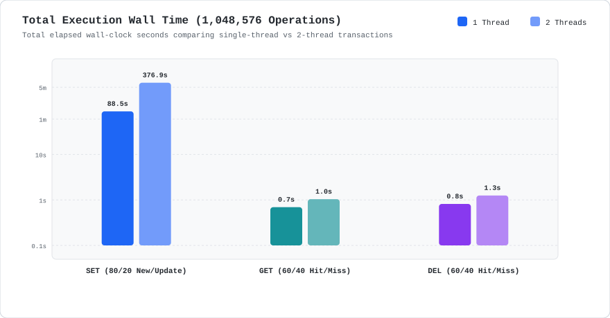

Translating throughput into real-world batch latency reveals the operational cost of NVMe commit
synchronization; batch point reads complete with sub-second execution, whereas persistent write
batches reflect the physical latency of dirty page flushing and OCC retry backoff

> [!NOTE]
> Point lookups and deletions execute lock-free via memory-mapped pages without shared locks; read
> scaling degradation is bounded by hardware CPU cache coherency and memory bus bandwidth across
> physical cores rather than engine-level synchronization barriers

### §2 · Tail Latency Spectrum & Percentile CDF

Latency distributions capture response times from median (`p50`) through extreme tail (`p99`,
`p999`, and `max`), isolating where lock contention and NVMe persistence barriers impact callers

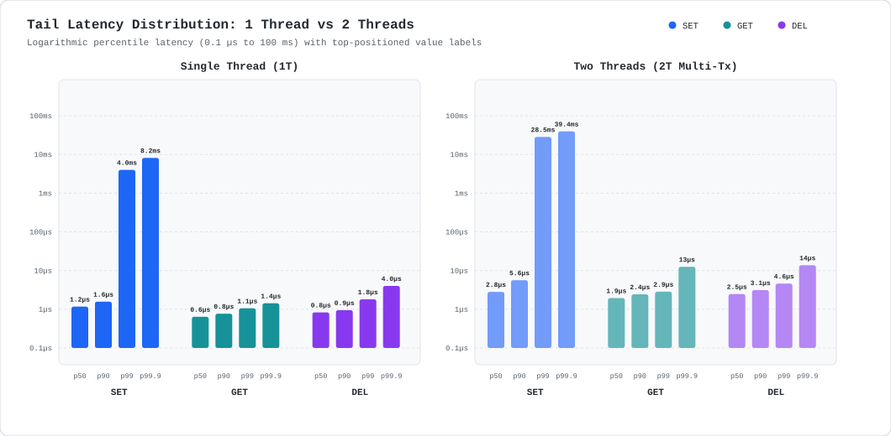

Read and delete operations exhibit near-flat percentile curves across the entire distribution,

* Point lookups (`GET`): Median latency remains sub-microsecond; at higher percentiles up to `p99`,
  latencies stay tightly bounded under lock-free memory mapping
* Key deletions (`DEL`): Deletions execute in place with bounded percentile progression, reclaiming
  slots without triggering page table re-allocation
* Zero heap allocation on miss: Missing keys resolve via hash routing without traversing payload
  pages, avoiding memory allocator pressure and eliminating GC-style tail pauses

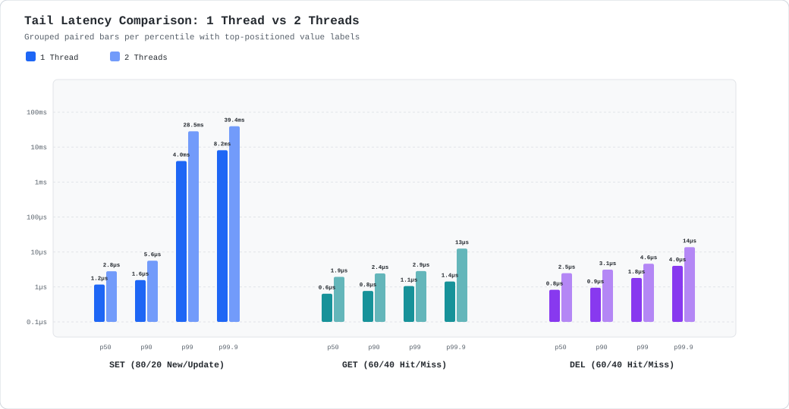

Direct head-to-head comparisons across percentile SLA tiers illustrate exact contention divergence;
while median latencies across workloads remain tight, write tail latencies expand at higher tiers
under multi-threaded contention due to OCC validation conflicts and NVMe writeback serialization

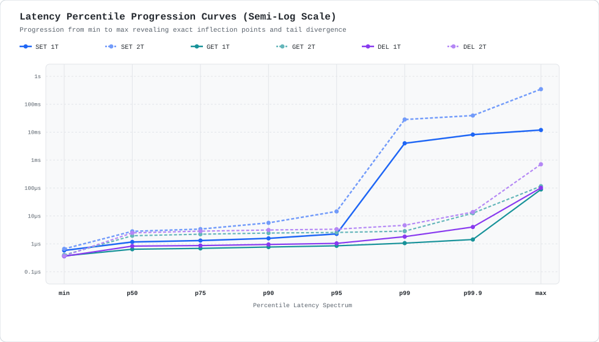

The semi-log percentile progression curves highlight the sharp inflection point for write mutations,

* Sub-microsecond median write: Sequential writes commit into active memory pages with low median
  latency
* NVMe writeback & OCC retry tail: Latency diverges past the upper percentiles, reflecting the cost
  of kernel dirty page flushing and OCC conflict aborts under heavy mutation pressure

> [!TIP]
> Sub-microsecond median dispatch holds across lock-free point operations; zero heap allocations on
> key-miss paths guarantee flat tail profiles across percentile tiers

### §3 · Memory Residency & Resident Set Size (RSS)

Peak resident set size (RSS) tracks actual physical memory consumed by host operating system page
tables and internal transaction state after completing 0x10_0000 operations

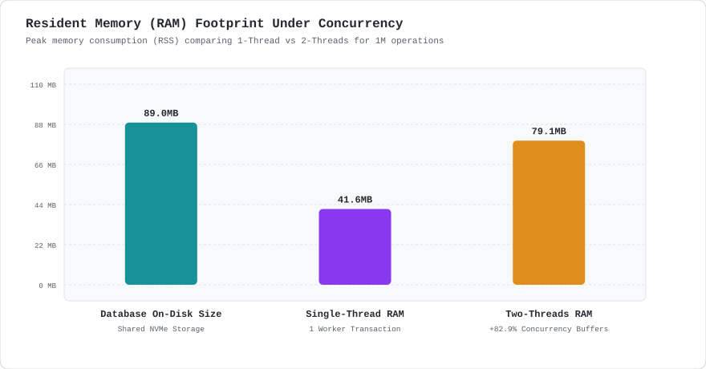

Physical storage growth on NVMe tracks sequential allocation while memory footprint remains bounded,

* Demand-paged single thread: Single-worker transactions maintain a resident memory footprint well
  below on-disk database size because unreferenced pages remain un-faulted by the kernel
* Concurrent worker buffers: Under concurrent worker transactions, resident RAM expands to back
  thread-local transaction commit logs, OCC validation buffers, and active memory-mapped pages
  faulted across distinct worker threads

> [!NOTE]
> Memory-mapped persistence utilizes OS page tables for on-demand caching; resident memory stays
> bounded by active working set size rather than total container file volume

### §4 · Cold-Open Latency & Index Memory Density

Initialization benchmarks evaluate cold database startup duration and memory scaling as stored key
volume grows from 0x00 to 0x8000 (32,768) keys; configurations contrast raw initialization against
eager in-memory lookup cache construction

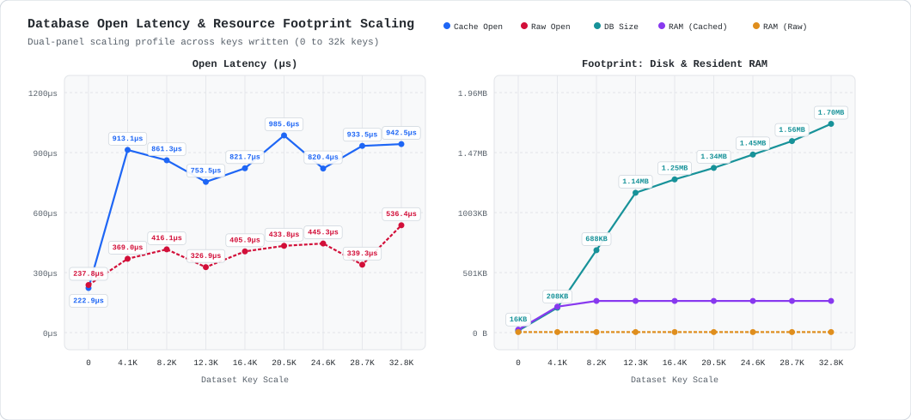

Cold startup behavior exhibits two distinct operational modes,

* Raw database open (`lookup_cache_disabled`): Bypasses key traversal entirely; startup latency
  remains sub-millisecond and flat; resident memory footprint remains pinned at a constant 4 KiB
  (0x1000 bytes) regardless of database size, as backing storage pages are mapped into virtual
  address space without being faulted into physical RAM
* Cached database open (`lookup_cache_enabled`): Traverses on-disk hash buckets at startup to
  pre-warm an in-memory hash index; initialization duration scales linearly with key count; this
  upfront cost amortizes lookup latencies for read-intensive workloads by routing subsequent reads
  in memory without disk navigation

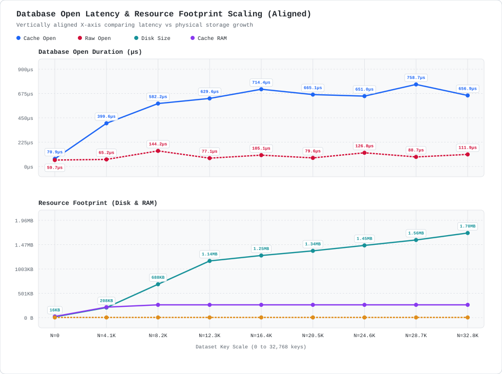

Aligning open duration directly against backing resource consumption over a shared key axis reveals
the proportional relationship between disk allocation and cache latency; physical disk space grows
monotonically without external fragmentation, while cached open latency tracks hash bucket depth
without experiencing non-linear compaction spikes

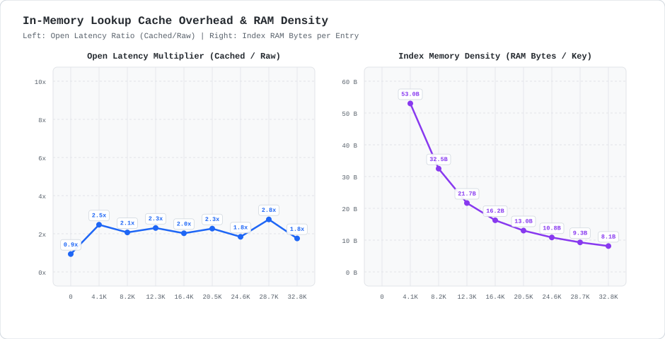

The cache overhead profile illustrates the operational trade-offs of eager indexing,

* Latency multiplier: The startup time ratio between cached and raw open remains bounded while cold
  open stays sub-millisecond across tested intervals
* Memory density: The in-memory lookup cache requires only a few bytes of physical RAM per indexed
  key, ensuring predictable memory budgets in embedded systems and edge runtime environments
* Monotonic storage growth: Backing storage expands monotonically in uniform OS page increments
  without allocation fragmentation or stop-the-world compaction cycles

> [!TIP]
> Uncached database open incurs zero heap allocation overhead, preserving a 4 KiB resident memory
> footprint across any key scale while keeping cold initialization strictly bounded

## Contributions

Contributions are welcome ;)

please feel free to submit a PR or open an issue if you have any feedback or suggestions
