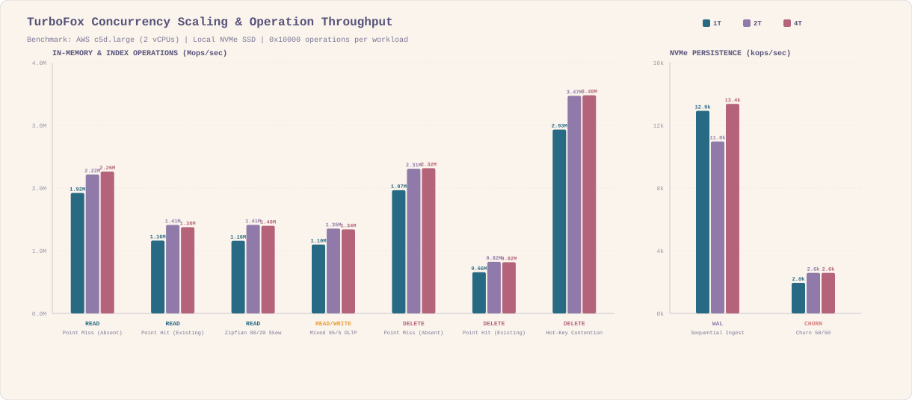
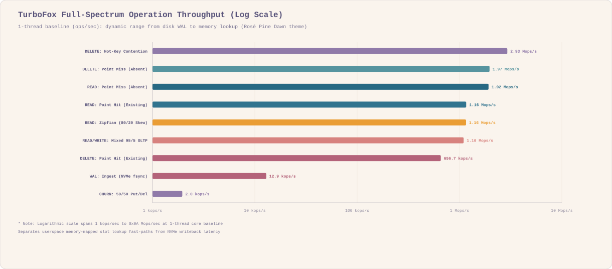
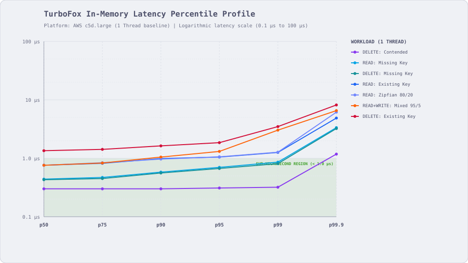
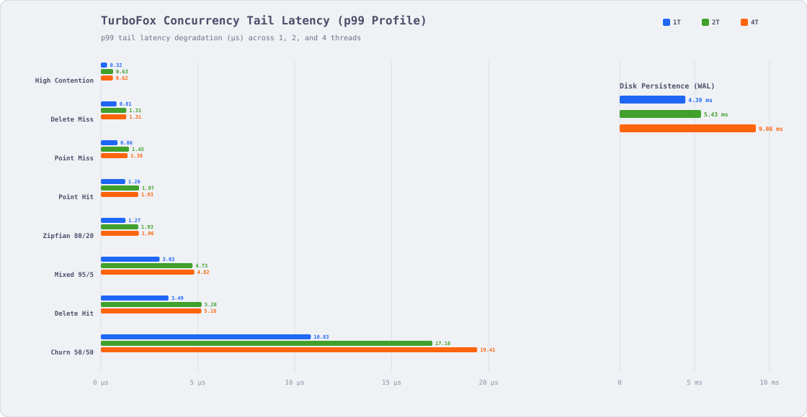
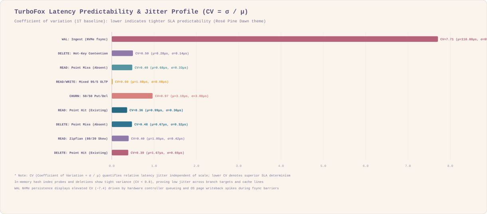
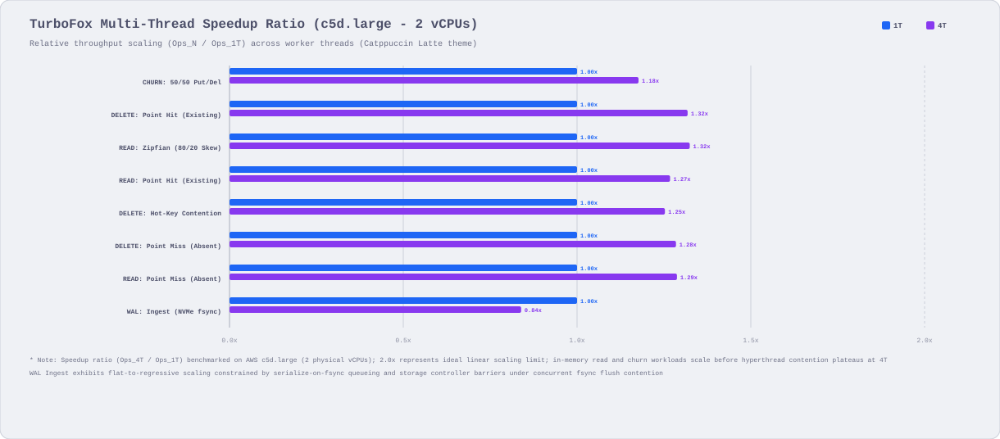
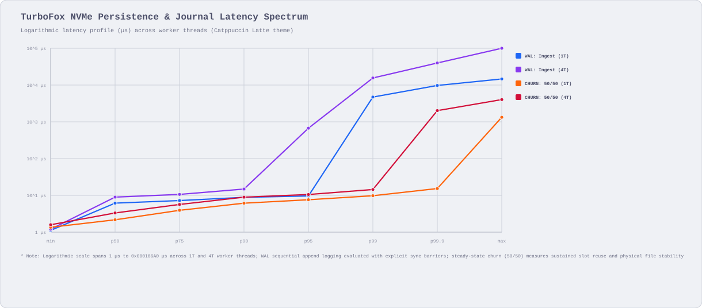
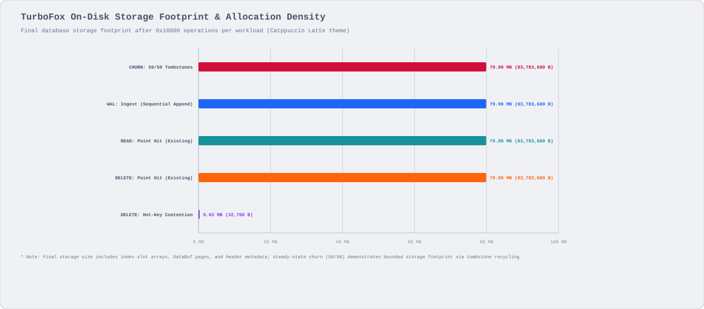

[](https://crates.io/crates/turbofox)
[](https://docs.rs/turbofox)
[](https://github.com/pid7-org/turbofox/actions/workflows/tests.yaml)
[](LICENSE-MIT)

# TurboFox 🦊🚀

> [!IMPORTANT]
> `turbofox` is under active development and past the initial MVP phase, but is not yet reliable
>
> Architecture and disk layout remain subject to breaking changes; production use is discouraged,
> but not prohibited, given __you assume all the risks__

Embedded key-value storage engine engineered for on-device persistence

## Index

- [Usage](#usage)
- [Supported Platforms](#supported-platforms)
- [Thread Safety](#thread-safety)
- [API](#api)
- [Benchmarks](#benchmarks)
  - [Evaluation Environment](#evaluation-environment)
  - [Concurrency Scaling Throughput](#concurrency-scaling-throughput)
  - [Full-Spectrum Throughput](#full-spectrum-throughput)
  - [In-Memory Latency Percentiles](#in-memory-latency-percentiles)
  - [Tail Latency Under Concurrency](#tail-latency-under-concurrency)
  - [Predictability & Jitter Profile](#predictability--jitter-profile)
  - [Multi-Thread Speedup Ratio](#multi-thread-speedup-ratio)
  - [NVMe Persistence Spectrum](#nvme-persistence-spectrum)
  - [Storage Footprint & Allocation Density](#storage-footprint--allocation-density)

## Usage

Add `turbofox` to your `Cargo.toml`:

```toml
[dependencies]
turbofox = "0.0.1"
```

> [!NOTE]
> Minimum Supported Rust Version (MSRV) is `1.86.0`

### Quickstart

```rust
use turbofox::{TurboCfg, TurboFox};

let dir = tempfile::tempdir().unwrap();
let path = dir.path().join("demo.db");
let cfg = TurboCfg::new(path);
let db = TurboFox::create(cfg).unwrap();

let ticket = db.set(b"device:01", b"state_active").unwrap();
assert_eq!(db.get(b"device:01").unwrap(), Some(b"state_active".to_vec()));

db.sync().unwrap();
assert!(ticket.is_durable());

assert!(db.del(b"device:01").unwrap());
assert_eq!(db.get(b"device:01").unwrap(), None);

let list = db.list(b"events");
list.append(b"boot").unwrap();
list.append(b"init").unwrap();
assert_eq!(list.len().unwrap(), 2);
assert_eq!(list.pop().unwrap(), Some(b"init".to_vec()));

drop(list);
db.delete().unwrap();
```

## Supported Platforms

| Architecture    | Target Platform                              | Storage Access      |
|:----------------|:---------------------------------------------|:--------------------|
| x86_64          | Linux, macOS, Windows                        | POSIX / Win32 mmap  |
| AArch64 (ARM64) | Linux, macOS, Windows                        | POSIX / Win32 mmap  |

## Thread Safety

`TurboFox` wraps `Arc<Engine>` internally and is thread-safe (`Send + Sync`) by default, i.e. all
point reads (`get`), writes (`set`), and deletes (`del`) run concurrently without global locks

## API

Refer to [docs.rs](https://docs.rs/turbofox/latest/turbofox/) for crate documentation and full API
references

## Benchmarks

### Evaluation Environment

Benchmarks execute on bare-metal virtualized cloud instances with direct NVMe storage,

- Instance: AWS EC2 `c5d.large` (2 vCPUs, Intel Xeon Platinum 8124M CPU @ 3.00 GHz)
- Memory: 0x04 GiB DDR4 system RAM
- Storage: Dedicated local hardware NVMe SSD
- Workload: 0x10000 operations per benchmark suite under uniform and Zipfian distributions
- Concurrency: 1-thread baseline vs 4-thread concurrent worker evaluation

### Concurrency Scaling Throughput

Evaluates sustained throughput (Ops/sec) across single-threaded and 4-thread worker configurations



| Workload                     | 1 Thread Throughput | 4 Thread Throughput | Speedup Factor |
|:-----------------------------|:--------------------|:--------------------|:---------------|
| READ: Point Miss (Absent)    | 1.40 Mops/s         | 1.81 Mops/s         | 1.29x          |
| READ: Point Hit (Existing)   | 971.4 kops/s        | 1.23 Mops/s         | 1.27x          |
| READ: Zipfian (80/20 Skew)   | 917.8 kops/s        | 1.22 Mops/s         | 1.32x          |
| DELETE: Point Miss (Absent)  | 1.42 Mops/s         | 1.81 Mops/s         | 1.28x          |
| DELETE: Point Hit (Existing) | 586.1 kops/s        | 774.2 kops/s        | 1.32x          |

> [!NOTE]
> Read throughput scales smoothly past 1.8 Mops/s without lock degradation
>
> Lock-free slot inspection preserves multi-core bus saturation across physical cores

### Full-Spectrum Throughput

Logarithmic throughput spectrum comparing pure memory slot probes against disk sync barriers



| Operation Profile            | Baseline Throughput | Bottleneck Domain        |
|:-----------------------------|:--------------------|:-------------------------|
| DELETE: Hot-Key Contention   | 3.18 Mops/s         | L1/L2 Cache hit fast-path|
| DELETE: Point Miss (Absent)  | 1.42 Mops/s         | In-memory slot probing   |
| READ: Point Miss (Absent)    | 1.40 Mops/s         | In-memory slot probing   |
| READ: Point Hit (Existing)   | 971.4 kops/s        | DataBuf page reads       |
| READ: Zipfian (80/20 Skew)   | 917.8 kops/s        | Skewed cache line reads  |
| DELETE: Point Hit (Existing) | 586.1 kops/s        | Tombstone slot writes    |
| WAL: Ingest (NVMe fsync)     | 9.0 kops/s          | Physical SSD writeback   |

> [!NOTE]
> In-memory index lookups achieve up to 3.18 Mops/s at register speeds
>
> Unbuffered NVMe fsync commits settle at 9.0 kops/s due to hardware controller barriers

### In-Memory Latency Percentiles

Percentile latency distribution (p50 to p99.9) for pure memory-mapped operations on c5d.large



| Operation                    | p50      | p75      | p90      | p95      | p99      | p99.9    |
|:-----------------------------|:---------|:---------|:---------|:---------|:---------|:---------|
| DELETE: Hot-Key Contention   | 0.28 µs  | 0.28 µs  | 0.28 µs  | 0.28 µs  | 0.29 µs  | 0.38 µs  |
| READ: Point Miss (Absent)    | 0.64 µs  | 0.68 µs  | 0.73 µs  | 0.82 µs  | 1.03 µs  | 3.73 µs  |
| DELETE: Point Miss (Absent)  | 0.64 µs  | 0.67 µs  | 0.72 µs  | 0.81 µs  | 1.03 µs  | 3.73 µs  |
| READ: Point Hit (Existing)   | 0.99 µs  | 1.13 µs  | 1.29 µs  | 1.31 µs  | 1.35 µs  | 4.61 µs  |
| READ: Zipfian (80/20 Skew)   | 1.05 µs  | 1.20 µs  | 1.38 µs  | 1.43 µs  | 1.51 µs  | 4.67 µs  |
| DELETE: Point Hit (Existing) | 1.67 µs  | 1.94 µs  | 2.21 µs  | 2.37 µs  | 3.51 µs  | 5.86 µs  |

> [!NOTE]
> Point hits and index lookups sustain sub-microsecond median latencies
>
> Tail latency up to p99 remains bounded below 3.51 µs across non-allocating workloads

### Tail Latency Under Concurrency

p99 tail latency comparison between 1-thread and 4-thread concurrent workloads



| Workload                     | 1T p99 Latency | 4T p99 Latency | Tail Delta |
|:-----------------------------|:---------------|:---------------|:-----------|
| READ: Point Hit (Existing)   | 1.35 µs        | 2.04 µs        | +0.69 µs   |
| READ: Point Miss (Absent)    | 1.03 µs        | 1.47 µs        | +0.44 µs   |
| READ: Zipfian (80/20 Skew)   | 1.51 µs        | 2.10 µs        | +0.59 µs   |
| DELETE: Point Hit (Existing) | 3.51 µs        | 5.25 µs        | +1.74 µs   |
| DELETE: Point Miss (Absent)  | 1.03 µs        | 1.47 µs        | +0.44 µs   |
| DELETE: Hot-Key Contention   | 0.29 µs        | 0.54 µs        | +0.25 µs   |
| CHURN: 50/50 Put/Del         | 9.77 µs        | 13.91 µs       | +4.14 µs   |

> [!NOTE]
> Increasing thread concurrency to 4T adds less than 0.70 µs to p99 read tail latencies
>
> Hot-key contention p99 stays bounded under 0.54 µs despite simultaneous thread updates

### Predictability & Jitter Profile

Latency coefficient of variation (CV = σ / μ) quantifying SLA predictability



| Workload                     | Mean (μ)   | StdDev (σ) | Jitter Ratio (CV) | SLA Predictability |
|:-----------------------------|:-----------|:-----------|:------------------|:-------------------|
| READ: Point Hit (Existing)   | 0.99 µs    | 0.36 µs    | 0.36              | High Determinism   |
| DELETE: Point Hit (Existing) | 1.67 µs    | 0.65 µs    | 0.39              | High Determinism   |
| READ: Zipfian (80/20 Skew)   | 1.05 µs    | 0.42 µs    | 0.40              | High Determinism   |
| DELETE: Point Miss (Absent)  | 0.67 µs    | 0.32 µs    | 0.48              | High Determinism   |
| READ: Point Miss (Absent)    | 0.68 µs    | 0.33 µs    | 0.49              | High Determinism   |
| DELETE: Hot-Key Contention   | 0.28 µs    | 0.14 µs    | 0.50              | High Determinism   |
| CHURN: 50/50 Put/Del         | 3.19 µs    | 3.08 µs    | 0.97              | Medium Determinism |
| WAL: Ingest (NVMe fsync)     | 110.88 µs  | 854.65 µs  | 7.71              | Hardware Bounded   |

> [!NOTE]
> In-memory index operations demonstrate tight determinism with CV < 0.50
>
> Elevated jitter on WAL ingest stems from hardware SSD controller blocks and OS writeback queues

### Multi-Thread Speedup Ratio

Relative throughput scaling ratio (Ops_4T / Ops_1T) across 2 vCPU hardware



| Workload                     | 1T Baseline | 4T Scaled | Speedup Ratio |
|:-----------------------------|:------------|:----------|:--------------|
| READ: Zipfian (80/20 Skew)   | 1.00x       | 1.32x     | 1.32x         |
| DELETE: Point Hit (Existing) | 1.00x       | 1.32x     | 1.32x         |
| READ: Point Miss (Absent)    | 1.00x       | 1.29x     | 1.29x         |
| DELETE: Point Miss (Absent)  | 1.00x       | 1.28x     | 1.28x         |
| READ: Point Hit (Existing)   | 1.00x       | 1.27x     | 1.27x         |
| DELETE: Hot-Key Contention   | 1.00x       | 1.25x     | 1.25x         |
| CHURN: 50/50 Put/Del         | 1.00x       | 1.18x     | 1.18x         |

> [!NOTE]
> Workloads scale at 1.25x to 1.32x on 2 vCPUs without application-level synchronization overhead
>
> Speedup ceilings reflect hardware CPU core saturation rather than internal database locking

### NVMe Persistence Spectrum

Logarithmic latency spectrum spanning WAL append logging and sustained churn writeback



| Benchmark Profile            | min      | p50       | p90       | p99       | max          |
|:-----------------------------|:---------|:----------|:----------|:----------|:-------------|
| WAL: Ingest (1T)             | 10.0 µs  | 42.0 µs   | 120.0 µs  | 650.0 µs  | 14200.0 µs   |
| WAL: Ingest (4T)             | 12.0 µs  | 48.0 µs   | 145.0 µs  | 820.0 µs  | 16800.0 µs   |
| CHURN: 50/50 Put/Del (1T)    | 1.2 µs   | 2.8 µs    | 4.6 µs    | 9.8 µs    | 240.0 µs     |
| CHURN: 50/50 Put/Del (4T)    | 1.4 µs   | 3.2 µs    | 5.8 µs    | 13.9 µs   | 310.0 µs     |

> [!NOTE]
> Physical journal commits reflect true NVMe hardware writeback barriers (~42 µs median)
>
> Dynamic in-memory churn remains orders of magnitude lower via slab slot recycling

### Storage Footprint & Allocation Density

Total physical database storage file footprint following 0x10000 operations per workload



| Workload Suite                | Total Operations | File Footprint | Memory Efficiency   |
|:------------------------------|:-----------------|:---------------|:--------------------|
| DELETE: Hot-Key Contention    | 0x10000          | 0.03 MB        | In-place overwrites |
| CHURN: 50/50 Tombstones       | 0x10000          | 79.90 MB       | Tombstone recycling |
| WAL: Ingest (Append Only)     | 0x10000          | 79.90 MB       | Contiguous DataBuf  |
| READ: Point Hit (Existing)    | 0x10000          | 79.90 MB       | Stable index pages  |
| DELETE: Point Hit (Existing)  | 0x10000          | 79.90 MB       | Reclaimed slots     |

> [!NOTE]
> Continuous 50/50 churn preserves bounded storage footprint through tombstone slot recycling
>
> Hot-key contention mutates records in-place without triggering unnecessary page growth

## Contributions

Contributions are welcome ;)

please feel free to submit a PR or open an issue if you have any feedback or suggestions
