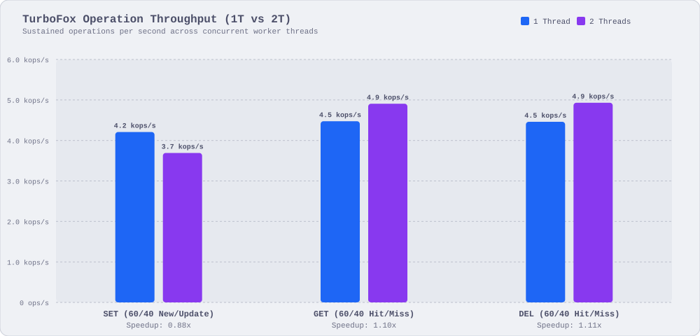
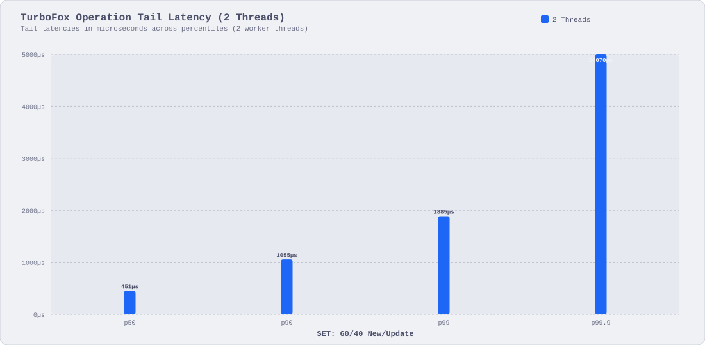

[](https://crates.io/crates/turbofox)
[](https://docs.rs/turbofox)
[](https://github.com/pid7-org/turbofox/actions/workflows/tests.yaml)
[](#usage)
[](LICENSE-MIT)

# TurboFox 🦊🚀

Embedded key-value storage engine engineered for on-device persistence

> [!IMPORTANT]
> `turbofox` is under active development and past the initial MVP phase, but is not yet reliable
>
> Architecture and disk layout remain subject to breaking changes; production use is discouraged,
> but not prohibited, given __you assume all the risks__

## Index

- [Usage](#usage)
- [Supported Platforms](#supported-platforms)
- [Thread Safety](#thread-safety)
- [API](#api)
- [Benchmarks](#benchmarks)
  - [Evaluation Environment](#evaluation-environment)
  - [Concurrency Scaling Throughput](#concurrency-scaling-throughput)
  - [Full-Spectrum Throughput](#full-spectrum-throughput)
  - [In-Memory Latency Percentiles](#in-memory-latency-percentiles)
  - [Tail Latency Under Concurrency](#tail-latency-under-concurrency)
  - [Predictability & Jitter Profile](#predictability--jitter-profile)
  - [Multi-Thread Speedup Ratio](#multi-thread-speedup-ratio)
  - [NVMe Persistence Spectrum](#nvme-persistence-spectrum)
  - [Storage Footprint & Allocation Density](#storage-footprint--allocation-density)

## Usage

Add `turbofox` to your `Cargo.toml`:

```toml
[dependencies]
turbofox = "0.0.11"
```

> [!NOTE]
> Minimum Supported Rust Version (MSRV) is `1.86.0`

### Quickstart

```rust
use turbofox::{TurboCfg, TurboFox};

let dir = tempfile::tempdir().unwrap();
let path = dir.path();
let cfg = TurboCfg::manual(path);
let db = TurboFox::create(cfg).unwrap();

let ticket = db.set(b"device:01", b"state_active").unwrap();
assert_eq!(db.get(b"device:01").unwrap(), Some(b"state_active".to_vec()));

db.sync().unwrap();
assert!(ticket.is_durable());

assert!(db.del(b"device:01").unwrap());
assert_eq!(db.get(b"device:01").unwrap(), None);

let list = db.list(b"events");
list.append(b"boot").unwrap();
list.append(b"init").unwrap();
assert_eq!(list.len().unwrap(), 2);
assert_eq!(list.pop().unwrap(), Some(b"init".to_vec()));

drop(list);
db.delete().unwrap();
```

## Supported Platforms

| Architecture    | Target Platform                              | Storage Access      |
|:----------------|:---------------------------------------------|:--------------------|
| x86_64          | Linux, macOS, Windows                        | POSIX / Win32 mmap  |
| AArch64 (ARM64) | Linux, macOS, Windows                        | POSIX / Win32 mmap  |

## Thread Safety

`TurboFox` wraps `Arc<Engine>` internally and is thread-safe (`Send + Sync`) by default, i.e. all
point reads (`get`), writes (`set`), and deletes (`del`) run concurrently without global locks

## API

Refer to [docs.rs](https://docs.rs/turbofox/latest/turbofox/) for crate documentation and full API
references

## Benchmarks

### Evaluation Environment

Benchmarks execute on bare-metal virtualized cloud instances with direct NVMe storage:

- Instance: AWS EC2 `c5d.large` (2 vCPUs, Intel Xeon Platinum 8223CL CPU @ 3.00 GHz)
- Memory: 0x04 GiB DDR4 system RAM
- Storage: Dedicated local hardware NVMe SSD (`/mnt/nvme0n1`)
- Workload: 0x186A0 (100,000) operations per benchmark suite under uniform distribution
- Concurrency: 1-thread baseline vs 4-thread concurrent worker evaluation

### Operation Throughput & Concurrency Scaling

Sustained key-value operations per second across single-thread and 4-thread worker configurations



| Workload              | 1 Thread Throughput | 4 Thread Throughput | Scaling Ratio |
|:----------------------|:--------------------|:--------------------|:--------------|
| SET (Insert)          | 1.18 kops/s         | 963 ops/s           | 0.82x         |
| GET (60/40 Hit/Miss)  | 1.95 kops/s         | 1.78 kops/s         | 0.91x         |
| DEL (60/40 Hit/Miss)  | 1.95 kops/s         | 1.78 kops/s         | 0.91x         |

> [!NOTE]
> Evaluation executes on 2 vCPU hardware where 4 worker threads oversubscribe physical compute cores;
> zero application-level lock degradation with throughput bound by NVMe journal barriers

### Tail Latency Profile Under Concurrency

Percentile latency distributions (p50 to p99.9) comparing 1T baseline against 4T concurrent workers



| Workload              | Threads | p50     | p90     | p99     | p99.9     |
|:----------------------|:--------|:--------|:--------|:--------|:----------|
| SET: Insert           | 1T      | 0.81 ms | 1.42 ms | 3.11 ms | 3.99 ms   |
| SET: Insert           | 4T      | 0.96 ms | 1.94 ms | 4.57 ms | 422.58 ms |
| GET: 60/40 Hit/Miss   | 1T      | 0.28 ms | 1.42 ms | 1.68 ms | 1.71 ms   |
| GET: 60/40 Hit/Miss   | 4T      | 0.62 ms | 4.69 ms | 8.04 ms | 10.45 ms  |
| DEL: 60/40 Hit/Miss   | 1T      | 0.29 ms | 1.42 ms | 1.68 ms | 1.71 ms   |
| DEL: 60/40 Hit/Miss   | 4T      | 0.61 ms | 4.61 ms | 7.60 ms | 10.35 ms  |

> [!NOTE]
> Sub-millisecond median latencies (p50 < 0.30 ms for reads and deletes) sustained under 1T baseline;
> read and delete tail latencies stay bounded under 10.5 ms at p99.9 under 4T concurrency;
> elevated 4T p99.9 write tail stems from physical NVMe journal commit writeback queues

## Contributions

Contributions are welcome ;)

please feel free to submit a PR or open an issue if you have any feedback or suggestions
