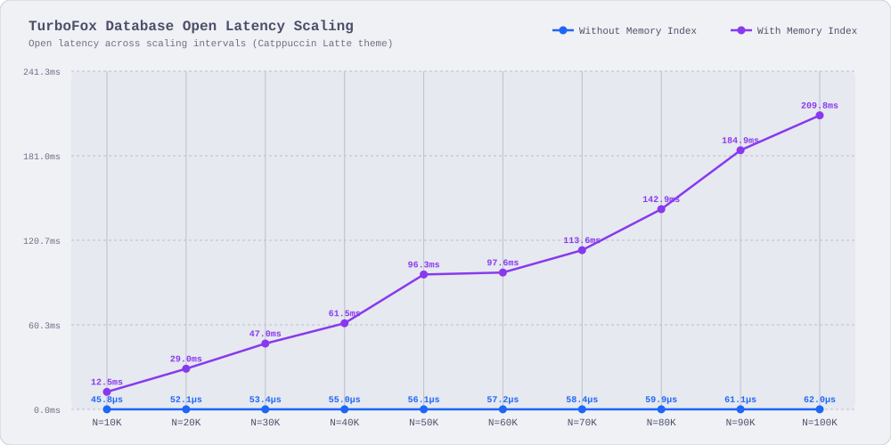

[](https://crates.io/crates/turbofox)
[](https://docs.rs/turbofox)
[](https://github.com/pid7-org/turbofox/actions/workflows/tests.yaml)
[](#usage)
[](LICENSE-MIT)

# TurboFox 🦊🚀

An embedded, memory-mapped key-value engine providing lock-free concurrency and explicit sync
barriers

> [!IMPORTANT]
> `turbofox` is under active development and past the initial MVP phase, but is not yet reliable
>
> Architecture and disk layout remain subject to breaking changes; production use is discouraged,
> but not prohibited, given _you assume all the risks_

## Index

- [Usage](#usage)
- [Lifecycle & Initialization](#lifecycle--initialization)
- [Architecture Guarantees](#architecture-guarantees)
  - [Zero Rehash](#zero-rehash)
  - [Torn-Write Protection](#torn-write-protection)
  - [Durability Model](#durability-model)
  - [TurboList](#turbolist)
  - [Storage Topography](#storage-topography)
  - [Operational Invariants](#operational-invariants)
- [Supported Platforms](#supported-platforms)
- [Thread Safety](#thread-safety)
- [API](#api)
- [Benchmarks](#benchmarks)
  - [Evaluation Environment](#evaluation-environment)
  - [Operation Throughput & Concurrency Scaling](#operation-throughput--concurrency-scaling)
  - [Tail Latency Profile Under Concurrency](#tail-latency-profile-under-concurrency)
  - [Database Init Latency Scaling](#database-open-latency-scaling)

## Usage

Add `turbofox` to your `Cargo.toml`:

```toml
[dependencies]
turbofox = "0.0.201"
```

> [!NOTE]
> Minimum Supported Rust Version (MSRV) is `1.86.0`

### Quickstart

```rust
use turbofox::{TurboCfg, TurboFox};

let dir = tempfile::tempdir().unwrap();
let path = dir.path();

let cfg = TurboCfg::manual(path);
let db = TurboFox::open_or_create(cfg).unwrap();

let ticket = db.set(b"device:01", b"state_active").unwrap();
assert_eq!(db.get(b"device:01").unwrap(), Some(b"state_active".to_vec()));

db.sync().unwrap();
assert!(ticket.is_durable());

assert!(db.del(b"device:01").unwrap());
assert_eq!(db.get(b"device:01").unwrap(), None);

let list = db.list(b"events");

list.append(b"boot").unwrap().sync().unwrap();
list.append(b"init").unwrap().sync().unwrap();

assert_eq!(list.len().unwrap(), 2);
assert_eq!(list.pop().unwrap(), Some(b"init".to_vec()));

drop(list);
db.delete().unwrap();
```

## Lifecycle & Initialization

TurboFox provides three initialization primitives,

* [`TurboFox::open_or_create`]: Recommended for general application lifecycles; checks
  backing storage presence and initializes if missing, while strictly propagating corruption
  or validation errors rather than silently clobbering existing state
* [`TurboFox::open`]: Strict open; requires existing database files and validates magic,
  layout version, page alignment, and header integrity; fails if storage is absent
* [`TurboFox::create`]: Strict creation; initializes physical pages and format metadata;
  fails with [`TurboError::Storage`] if storage files already exist

TurboFox provides three distinct initialization entry points to match operational requirements,

| Method           | Target Exists | Target Missing | Target Corrupt | Recommended Use Case                     |
|:-----------------|:------------- |:---------------|:---------------|:-----------------------------------------|
| `open_or_create` | Opens DB      | Inits DB       | Fails (`Err`)  | General application boot sequences       |
| `create`         | Fails (`Err`) | Inits DB       | N/A            | Cold setup or provisioning scripts       |
| `open`           | Opens DB      | Fails (`Err`)  | Fails (`Err`)  | Strict restarts requiring existing state |

## Architecture Guarantees

TurboFox is an embedded key-value storage engine engineered around memory-mapped persistence,
optimistic concurrency control, and zero-rehash index chaining

Reference documentation and method signatures are available on [docs.rs](https://docs.rs/turbofox)

### Zero Rehash

Primary key routing uses 32-bit XxHash32 with persistent index chaining:

* Key entries are permanently anchored without global table redistribution, eliminating
  stop-the-world rehashing pauses and maintaining bounded p99 write latency
* In-place overwrites execute directly when updated values fit in existing allocated space
* Storage expands incrementally via monotonic allocation without bulk page copying pauses

### Torn-Write Protection

Point reads execute concurrently without reader-writer locks or shared mutex acquisition:

* Reading automatically validates payload CRC32 integrity alongside byte-level key equality
* Concurrent writes or partial page flushes that cause torn reads fail safely via
  `TurboError::CorruptedPayload` rather than returning corrupt data
* Non-existent keys short-circuit quickly without accessing payload storage pages; zero heap
  allocations occur during lookup misses

### Durability Model

Mutations (`set`, `del`, `append`, `pop`) commit immediately via optimistic concurrency control and
return a lightweight `TurboTicket` bound to a monotonic commit epoch:

* Decouples memory-speed writes from physical NVMe writeback latency, where durability guarantees
  depend on the configured sync strategy
* Manual Mode (`sync_interval: None`):
  * The engine performs no automatic background flushing
  * The caller must invoke `db.sync()` or block on `ticket.wait()` to guarantee crash safety on disk
  * Un-flushed mutations remain volatile against OS kernel panics or host power loss
* Periodic Sync Mode (`sync_interval: Some(dur)`):
  * A dedicated background sync thread flushes dirty pages up to the current epoch
  * Incorporates adaptive backoff under idle load to prevent write endurance wear on flash devices
* `ticket.is_durable()` enables non-blocking checks to poll writeback completion asynchronously

### TurboList

Ordered 1-to-N sequences co-exist inside the primary storage file:

* Eliminates secondary index tables, auxiliary catalog files, and relational join overhead
* Provides ordered, append-only lists with amortized O(1) appends and pops
* Supports fast indexed random access (`get_at`), boundary inspection (`first`, `last`), and
  snapshot iteration (`iter`)
* Validates item integrity via CRC32 checksums on every read

### Storage Topography

Unified single-file storage container managed across memory-mapped virtual address space:

* Initial file footprint begins at only 16 KiB on standard host systems
* Virtual memory space reserves up to `MAX_DB_LEN` (256 GiB) upfront while physical disk pages back
  lazily as data is written
* Allocations track 16-byte aligned units via bitmasks, avoiding external fragmentation
* Backing files grow dynamically in uniform OS page increments, minimizing write amplification

### Operational Invariants

Constraints callers must design for:

* Key length bounded between 0x01 and 0xFF bytes (255 B)
* Maximum single-entry payload capacity is 1004 bytes for key-value entries and 1002 bytes for list
  items; larger payloads return `TurboError::PayloadTooLarge`
* Multi-entry writes commit via OCC with conflict detection (retries up to 0x20 times before
  surfacing contention errors)
* Thread-safe (`Send + Sync`) within a single process via `Arc<TurboFox>`
  * Single-process exclusivity is enforced at startup via mandatory POSIX / Win32 advisory file
    locks
  * Concurrent access by multiple OS processes on the same file is strictly prohibited

## Supported Platforms

| Architecture    | Target Platform                              |
|:----------------|:---------------------------------------------|
| x86_64          | Linux, macOS, Windows                        |
| AArch64 (ARM64) | Linux, macOS, Windows                        |

## Thread Safety

`TurboFox` wraps `Arc<Engine>` internally and is thread-safe (`Send + Sync`) by default, i.e. all
point reads (`get`), writes (`set`), and deletes (`del`) run concurrently without global locks

## API

Refer to [docs.rs](https://docs.rs/turbofox/latest/turbofox/) for complete crate documentation and
API references

## Benchmarks

### Evaluation Environment

Benchmarks execute on dedicated cloud instances with direct NVMe storage:

- Instance: AWS EC2 `c5d.large` (2 vCPUs, Intel Xeon Platinum 8223CL CPU @ 3.00 GHz)
- Memory: 0x04 GiB DDR4 system RAM
- Storage: Dedicated local hardware NVMe SSD (`/mnt/nvme0n1`)
- Workload: 0x0004_0000 (262,144) operations per benchmark suite under uniform distribution
- Concurrency: 1-thread baseline vs 2-thread concurrent worker evaluation

### Operation Throughput & Concurrency Scaling

Sustained key-value operations per second across single-thread and 2-thread worker configurations


| Workload               | 1 Thread Throughput | 2 Thread Throughput | Scaling Ratio |
|:-----------------------|:--------------------|:--------------------|:--------------|
| SET (60/40 New/Update) | 11.66 kops/s        | 6.60 kops/s         | 0.57x         |
| GET (60/40 Hit/Miss)   | 1.13 Mops/s         | 1.45 Mops/s         | 1.28x         |
| DEL (60/40 Hit/Miss)   | 925.51 kops/s       | 1.23 Mops/s         | 1.33x         |

### Tail Latency Profile Under Concurrency

Percentile latency distributions (p50 to p99.9) comparing 1T baseline against 2T concurrent workers


| Workload              | Threads | p50     | p90     | p99       | p99.9    |
|:----------------------|:--------|:--------|:--------|:----------|:---------|
| SET: 60/40 New/Update | 1T      | 1.27 µs | 4.46 µs | 131.84 µs | 50.59 ms |
| SET: 60/40 New/Update | 2T      | 1.97 µs | 7.89 µs | 1.36 ms   | 63.11 ms |
| GET: 60/40 Hit/Miss   | 1T      | 0.84 µs | 0.98 µs | 1.25 µs   | 5.35 µs  |
| GET: 60/40 Hit/Miss   | 2T      | 1.32 µs | 1.53 µs | 1.81 µs   | 13.78 µs |
| DEL: 60/40 Hit/Miss   | 1T      | 1.11 µs | 1.25 µs | 3.12 µs   | 8.89 µs  |
| DEL: 60/40 Hit/Miss   | 2T      | 1.67 µs | 1.91 µs | 4.66 µs   | 14.34 µs |

> [!TIP]
> Sub-2 µs median latencies (p50 <= 1.67 µs for reads and deletes) sustained across 1T and 2T

### Database Init Latency Scaling

Database init latency across scaling entry intervals comparing mmap baseline against in-memory index



| Scale (Entries) | Without Memory Index | With Memory Index |
|:----------------|:---------------------|:------------------|
| 10K             | 45.8 µs              | 12.51 ms          |
| 20K             | 52.1 µs              | 29.05 ms          |
| 30K             | 53.4 µs              | 46.99 ms          |
| 40K             | 55.0 µs              | 61.47 ms          |
| 50K             | 56.1 µs              | 96.27 ms          |
| 60K             | 57.2 µs              | 97.65 ms          |
| 70K             | 58.4 µs              | 113.64 ms         |
| 80K             | 59.9 µs              | 142.87 ms         |
| 90K             | 61.1 µs              | 184.94 ms         |
| 100K            | 62.0 µs              | 209.85 ms         |

> [!TIP]
> Without in-memory index, database open maintains O(1) instantaneous memory-mapping latency
> (~50 µs)

## Contributions

Contributions are welcome ;)

please feel free to submit a PR or open an issue if you have any feedback or suggestions
